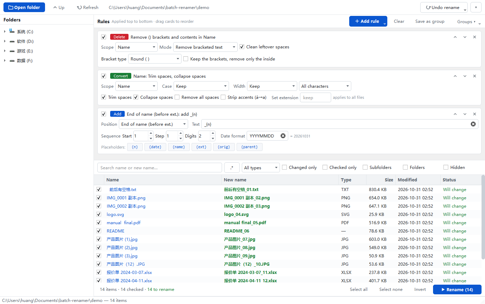
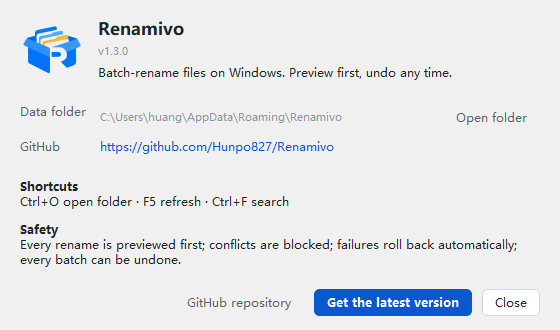

<div align="center">


# Renamivo

**Batch file renamer for Windows — preview everything, apply once, undo any time.**

[](https://github.com/Hunpo827/Renamivo/actions/workflows/release.yml)
[](LICENSE)
[](#download)

**English** · [简体中文](README.md)

</div>

---

Pick a folder on the left, stack rules on the right, watch every `old name → new name` update live at
the bottom. Nothing touches the disk until you confirm.



## The window

| Area | What it does |
| --- | --- |
| **Folder tree (left)** | Click a folder to switch to it; you can also drag a folder onto the window. |
| **Rules (top right)** | Rules run **top to bottom** — each one receives the previous result. Drag a card by its header to reorder, or use the ↑ ↓ buttons. |
| **File list (bottom right)** | Live `old → new` preview. Green = will change, grey = unchanged, red = conflict or invalid. The checkbox in the first column decides whether that row takes part; it survives sorting and filtering. |
| **Action bar** | Shows `N items / M checked / K to rename / X conflicts`. The rename button only lights up when something is actually going to change. |

<div align="center">

</div>

## Rules

| Rule | What it can do |
| --- | --- |
| **Add** | Insert text at the **beginning**, at the **end of the name (before the extension)** or **after the extension**, with sequence and timestamp placeholders |
| **Delete** | Remove literal text, a regex match, N characters from either end, or bracketed content (round / square / curly / angle / CJK brackets) |
| **Replace** | Find and replace, with regex and `\1` / `$1` group references; leave the replacement empty to delete |
| **Convert** | Letter case, full-width ↔ half-width, trim/collapse/remove spaces, strip accents (á→a), force an extension |

Placeholders available in **Add**:

| Token | Meaning | Example |
| --- | --- | --- |
| `{n}` | Sequence number (start / step / zero-padding) | `001` `002` |
| `{date}` `{time}` | Current time (`YYYYMMDD` or `%Y%m%d`) | `20261031` |
| `{name}` | Current stem | `product (1)` |
| `{ext}` | Extension | `jpg` |
| `{orig}` | Original full filename | `product (1).jpg` |
| `{parent}` | Parent folder name | `archive-2024` |

Need `part-003`, `[003]` or `(3)`? Just type it around `{n}` — no format picker needed.

**Scope** (delete / replace / convert) can target the name, the extension, or the whole filename.
The default is the name only, so a careless replace will never lowercase your `JPG`.

## Safety

1. **Preview first, apply second.** Editing rules only updates the preview; a confirmation dialog lists the changes before anything is written.
2. **Conflicts are blocked.** Illegal characters, reserved names (`CON`, `PRN`, `COM1`…), trailing spaces or dots, names over 255 characters, duplicates within the batch, existing targets — all flagged red and skipped by default.
3. **Two-phase rename.** Every file is renamed to a temporary name first, so `a.txt → A.txt` (case-only) and `a ↔ b` swaps both work correctly on Windows.
4. **Automatic rollback.** If any step fails, everything already renamed is restored.
5. **Crash recovery.** Renames are journalled; if the app dies mid-batch, the next start offers to restore the previous state.
6. **One-click undo.** The last 30 batches are kept and can be reverted wholesale (after checking the original names are still free).
7. **Clear result.** After a run you get the exact success/failure counts, with per-file reasons for failures.

## Download

Grab **`Renamivo-Single.exe`** (~47 MB) from [Releases](https://github.com/Hunpo827/Renamivo/releases/latest).
Double-click to run, no installation. Windows 10 / 11 (x64).

> The binary is not code-signed, so SmartScreen may warn about an unknown publisher — choose
> "More info → Run anyway". Systems with Smart App Control enabled may block unsigned executables
> outright; in that case run from source.

## Also worth knowing

- **Bilingual UI** (Chinese / English), following the system language on first launch; switch it from the `⚙` menu.
- **Rule groups**: save a rule stack and reload it later; the last used rules are restored on restart.
- **Filtering**: search (regex toggle), by file type, changed-only, checked-only, recursive subfolders.
- **Shortcuts**: `Ctrl+O` open folder · `F5` refresh · `Ctrl+F` search.
- **Context menu**: reveal in Explorer, copy name / new name / full path.

## Run from source

```cmd
git clone https://github.com/Hunpo827/Renamivo.git
cd Renamivo
uv venv --python 3.12 .venv
uv pip install --python .venv\Scripts\python.exe PySide6
.venv\Scripts\python.exe -m renamer
```

Pure Python + PySide6, nothing else at runtime. The core logic (`renamer/core/`) has no Qt
dependency and is unit-tested on its own:

```cmd
uv pip install --python .venv\Scripts\python.exe pytest
.venv\Scripts\python.exe -m pytest tests -q
```

## Build & release

Releases are built by **GitHub Actions**: push a tag and a Windows runner runs the tests, builds the
exe and creates the release with the binary attached.

```cmd
git tag v1.3.1 && git push origin v1.3.1
```

Local build:

```cmd
uv pip install --python .venv\Scripts\python.exe pyinstaller
.venv\Scripts\pyinstaller.exe --noconfirm --clean --windowed --onefile ^
  --name Renamivo-Single --icon assets\icon.ico --add-data "assets;assets" ^
  --version-file packaging\version_info.txt run.pyw
```

## Layout

```
renamer/
  core/            pure logic, no Qt — unit tested
    naming.py        name splitting, case, width, placeholders, natural sort
    rules.py         the four rules (rule chain)
    scanner.py       directory scanning
    validator.py     legality / conflict checks
    executor.py      two-phase rename + journal + rollback
    history.py       undo history
  ui/              PySide6 widgets
  i18n.py          Chinese/English strings
  meta.py          version, GitHub repo
  app.py           entry point
tests/             42 unit tests
dev/               dev scripts (screenshots, end-to-end tests, fixtures)
packaging/         version resource and release notes
assets/            app icon and toolbar icons
```

## Known limits

- Renames only — it never moves, copies or deletes files.
- Recursive mode renames in place; the folder structure is untouched.
- Network drives and read-only files fail and roll back.
- Sequence numbers follow the current list order, so re-sort before numbering another batch.

## License

[Apache License 2.0](LICENSE) © 2026 Hunpo827
