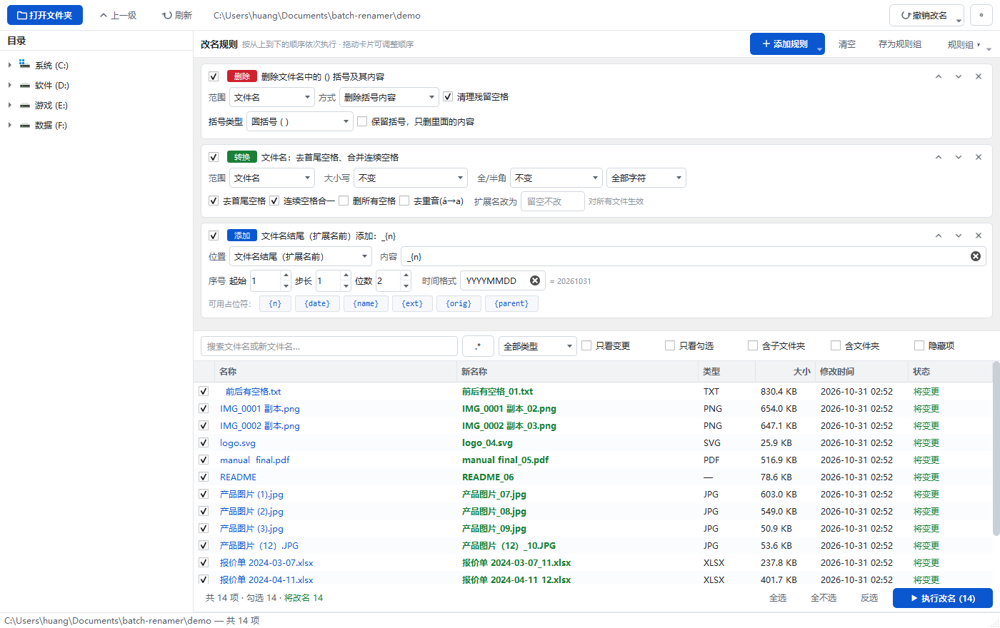
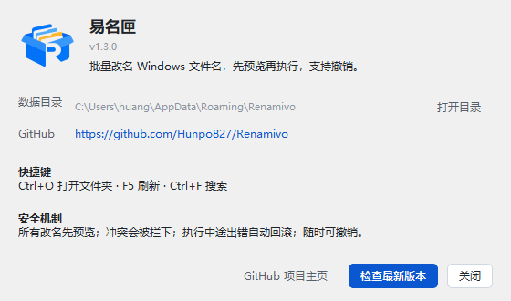

<div align="center">


# 易名匣 · Renamivo

**Windows 上的批量文件改名工具 —— 先预览、后执行、随时撤销。**

[](https://github.com/Hunpo827/Renamivo/actions/workflows/release.yml)
[](LICENSE)
[](#下载)

[English](README.en.md) · **简体中文**

</div>

---

左边选目录，右边写规则，下面实时看「原名 → 新名」，确认之后才真正动磁盘。规则可以叠加、拖动排序、存成规则组复用。



## 界面说明

| 区域 | 作用 |
| --- | --- |
| **左侧目录树** | 单击目录即切换；也可以把文件夹直接拖进窗口。下方列表默认只显示当前目录的第一层。 |
| **右上规则区** | 规则**从上到下依次执行**，前一条的结果就是后一条的输入。按住卡片标题栏可上下拖动排序，也可以用 ↑ ↓ 微调。 |
| **右下文件列表** | 实时显示「原名 → 新名」。绿色 = 会改，灰色 = 无变化，红色 = 冲突/非法。首列勾选框决定这一行参不参与改名，勾选状态跨排序、跨筛选保留。 |
| **底部操作条** | 显示「共 N 项 / 勾选 M / 将改名 K / 冲突 X」，右侧是执行按钮，只有存在可改名项时才亮起。 |

<div align="center">

</div>

## 四种规则

| 规则 | 能做什么 |
| --- | --- |
| **添加** | 在文件名**开头** / **文件名结尾（扩展名前）** / **扩展名之后**插入内容，支持序号与时间占位符 |
| **删除** | 删除指定文字、正则匹配、按位置删 N 个字符、删除括号内容（圆/方/花/尖/中文括号） |
| **替换** | 查找替换，支持正则与 `\1` / `$1` 分组引用；替换为留空即删除 |
| **转换** | 大小写、全角↔半角、去首尾空格、连续空格合一、删所有空格、去重音（á→a）、统一扩展名 |

**添加**规则里可用的占位符：

| 占位符 | 含义 | 示例 |
| --- | --- | --- |
| `{n}` | 序号（起始值 / 步长 / 补零位数可调） | `001` `002` |
| `{date}` `{time}` | 当前时间（`YYYYMMDD` 或 `%Y%m%d`） | `20261031` |
| `{name}` | 当前主名 | `产品图片 (1)` |
| `{ext}` | 扩展名 | `jpg` |
| `{orig}` | 最初的文件全名 | `产品图片 (1).jpg` |
| `{parent}` | 所在文件夹名 | `2024年存档` |

想写成 `第3章`、`[003]`、`(3)` 都行——把这些字直接打进去，`{n}` 就是数字。

**作用范围**（删除/替换/转换）可选「文件名 / 扩展名 / 整个文件名」，默认只动文件名，扩展名不会被误伤。

## 安全机制

1. **先预览、后执行**：改规则只更新预览，不碰磁盘；执行前列出改动让你确认。
2. **冲突拦截**：非法字符、系统保留名（CON/PRN/COM1…）、结尾空格或点、超 255 字符、批内重名、目标已存在——全部标红，默认跳过。
3. **两阶段改名**：先改成临时名再改成目标名，`a.txt → A.txt`（只改大小写）和 `a ↔ b` 互换都能正确执行。
4. **失败自动回滚**：中途任何一步出错，已改的全部改回去。
5. **断电可恢复**：改名过程写日志，中途崩溃下次启动会问是否恢复原状。
6. **一键撤销**：保留最近 30 批改名记录，可整体还原（还原前会检查原名称是否被占用）。
7. **结果提示**：执行完明确告诉你成功几个、失败几个，失败的可展开看原因。

## 下载

从 [Releases](https://github.com/Hunpo827/Renamivo/releases/latest) 下载 **`Renamivo-Single.exe`**（约 47 MB），双击即可运行，无需安装，支持 Windows 10 / 11。

> 程序未做代码签名，SmartScreen 可能提示「未知发布者」，选择「更多信息 → 仍要运行」即可。
> 开启了「智能应用控制」的系统可能直接拦截未签名程序，这种情况请用源码运行。

## 其他

- **语言**：中英文，首次启动跟随系统语言（中文→中文，英文→英文，其他语言一律英文），可在 `⚙` 里手动切换。
- **规则组**：常用规则组合可以「存为规则组」，下次一键载入；关窗口也会自动记住当前规则。
- **筛选**：搜索（可切正则）、按文件类型、只看变更、只看勾选、含子文件夹递归。
- **快捷键**：`Ctrl+O` 打开文件夹 · `F5` 刷新 · `Ctrl+F` 搜索
- **右键**：在资源管理器中显示、复制文件名 / 新文件名 / 完整路径

## 从源码运行

```cmd
git clone https://github.com/Hunpo827/Renamivo.git
cd Renamivo
uv venv --python 3.12 .venv
uv pip install --python .venv\Scripts\python.exe PySide6
.venv\Scripts\python.exe -m renamer
```

纯 Python + PySide6，没有其他运行时依赖。核心逻辑（`renamer/core/`）不依赖 Qt，可单独跑测试：

```cmd
uv pip install --python .venv\Scripts\python.exe pytest
.venv\Scripts\python.exe -m pytest tests -q
```

## 打包与发版

**发版走 GitHub Actions**：推 tag 即可，GitHub 的 Windows runner 会自动跑测试、打包、创建 Release 并挂上单文件 exe。

```cmd
git tag v1.3.1 && git push origin v1.3.1
```

本地打包：

```cmd
uv pip install --python .venv\Scripts\python.exe pyinstaller
.venv\Scripts\pyinstaller.exe --noconfirm --clean --windowed --onefile ^
  --name Renamivo-Single --icon assets\icon.ico --add-data "assets;assets" ^
  --version-file packaging\version_info.txt run.pyw
```

## 目录结构

```
renamer/
  core/            纯逻辑，不依赖 Qt，可单元测试
    naming.py        名称拆分、大小写、全半角、占位符、自然排序
    rules.py         四种规则的实现（规则链）
    scanner.py       目录扫描
    validator.py     合法性 / 冲突检查
    executor.py      两阶段改名 + 日志 + 回滚
    history.py       撤销历史
  ui/              界面（PySide6）
  i18n.py          中英文案
  meta.py          版本号、GitHub 仓库地址
  app.py           入口
tests/             42 项单元测试
dev/               开发脚本（截图、端到端测试、造测试数据）
packaging/         版本资源与 Release 说明
assets/            应用图标与工具栏图标
```

## 已知边界

- 只做**改名**，不移动、不复制、不删除文件。
- 递归扫描时改名不会改变文件的存放位置。
- 网络盘 / 只读文件改名会失败并回滚。
- 序号按「列表当前显示顺序」分配，改完一批后请重新排序再编号。

## License

[Apache License 2.0](LICENSE) © 2026 Hunpo827
